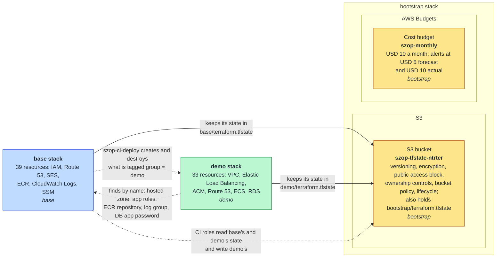
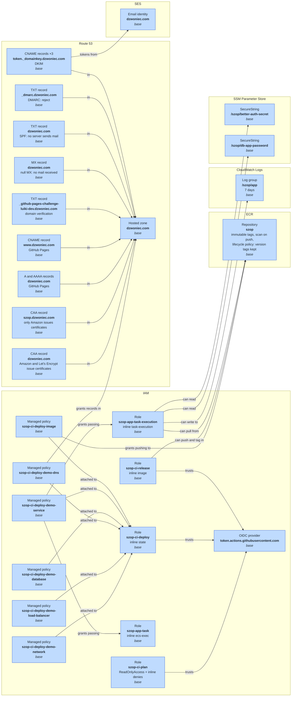
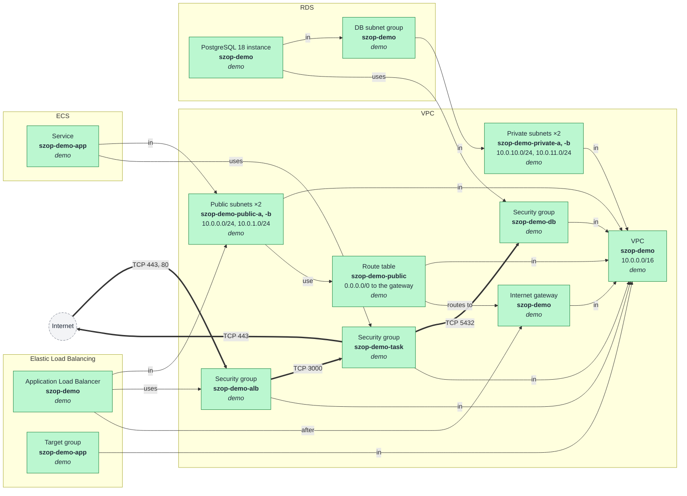
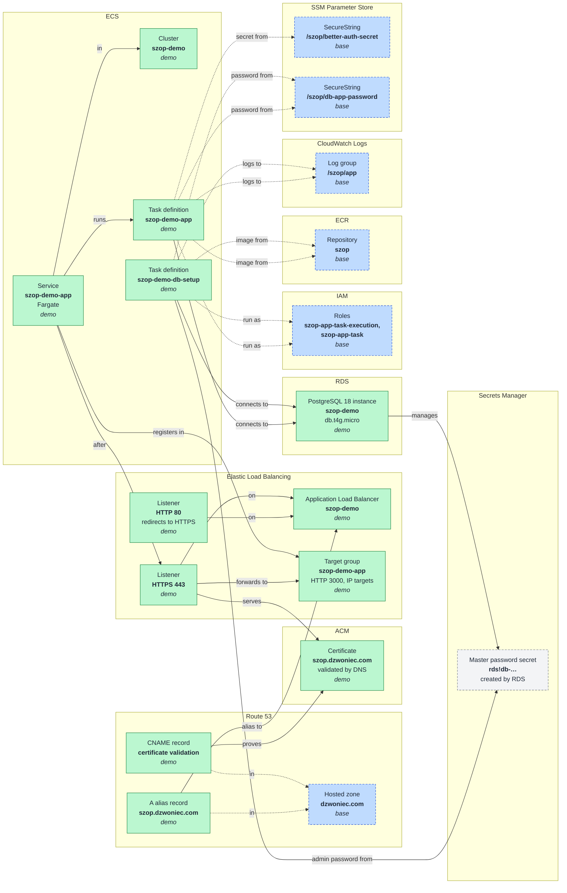

# AWS resources

Every AWS resource the Terraform code under `infra/` creates, drawn as diagrams. The [overview](#overview) shows the three root modules (stacks), how they depend on each other, and bootstrap's own two resources. [Base](#base) gets a detailed diagram, grouped by AWS service, and [demo](#demo) gets two: one for the network, one for the load balancer, the app and the database. Update this file when a resource, or a reference between resources, changes in `infra/`.

## Contents

- [Reading the diagrams](#reading-the-diagrams)
- [Overview](#overview)
- [Base](#base)
- [Demo](#demo)
  - [Network and traffic](#network-and-traffic)
  - [Load balancer, app and database](#load-balancer-app-and-database)

## Reading the diagrams

- **Boxes** are resources. Each box shows the kind of resource, its name in AWS (in bold) and, on the last line, the stack it belongs to: `bootstrap`, `base` or `demo`. The colour shows the stack too:
  - yellow: bootstrap
  - blue: base
  - green: demo
  - blue with a dashed border, in the demo diagrams: a base resource that demo finds by name
  - grey with a dashed border: something Terraform does not create, such as the internet or the secret RDS creates for itself
- **Frames** group the boxes by AWS service. In the overview, the outer frames are the stacks.
- **Arrows** point from the resource that refers to another to the one it refers to, and the label says how it uses it. A Terraform reference (`aws_vpc.main.id`) or a `depends_on` draws a solid arrow.
- **Dashed arrows** are references made by name or by an Amazon Resource Name (ARN) put together from a name, not through Terraform's own graph. That is how demo reaches base's resources ([PH-12b spec](../superpowers/specs/2026-10-18-PH-12b-network-and-the-demo-up-button-design.md), decision 1).
- **Thick arrows** are the traffic security groups let through, with the protocol and port. Each one stands for the pair of rules behind it: the sender's egress rule and the receiver's ingress rule.
- **Folded resources.** A box can hold more than one resource. Settings resources are folded into the resource they configure: the bucket's versioning, or a role's inline policy. Look-alike resources share a box with a count: the three DKIM records, the two public subnets. The table under each diagram lists every Terraform resource and the box that holds it. The `aws_iam_policy_document` data sources are left out: they only build JSON at plan time.

## Overview

Bootstrap is applied first and once, by hand. It creates the bucket that every stack, bootstrap included, keeps its state in, and the monthly budget. Base holds what lives as long as the project does. Demo holds what demo-up creates and demo-down destroys.

| Box | Terraform resources |
|---|---|
| S3 bucket `szop-tfstate-ntrtcr` | `aws_s3_bucket.state`, `aws_s3_bucket_versioning.state`, `aws_s3_bucket_server_side_encryption_configuration.state`, `aws_s3_bucket_public_access_block.state`, `aws_s3_bucket_ownership_controls.state`, `aws_s3_bucket_policy.state`, `aws_s3_bucket_lifecycle_configuration.state` |
| Cost budget `szop-monthly` | `aws_budgets_budget.monthly` |

## Base

The roles CI and the app run with, the domain's DNS zone and email records, the image registry, the app's log group and its secrets.

The managed policies attached to `szop-ci-deploy` reach demo's resources by their tags and ARN patterns, not by reference, so the diagram draws no arrows from them into demo. The overview shows that link. The same goes for the task execution role's grant on the master password secret RDS creates in demo.

| Box | Terraform resources |
|---|---|
| OIDC provider | `aws_iam_openid_connect_provider.github` |
| Role `szop-ci-plan` | `aws_iam_role.ci_plan`, `aws_iam_role_policy_attachment.ci_plan_read_only` (the AWS managed `ReadOnlyAccess`), `aws_iam_role_policy.ci_plan_denies` |
| Role `szop-ci-deploy` | `aws_iam_role.ci_deploy`, `aws_iam_role_policy.ci_deploy_state` |
| Managed policy `szop-ci-deploy-demo-network` | `aws_iam_policy.ci_deploy_demo_network`, `aws_iam_role_policy_attachment.ci_deploy_demo_network` (the arrow) |
| Managed policy `szop-ci-deploy-demo-load-balancer` | `aws_iam_policy.ci_deploy_demo_load_balancer`, `aws_iam_role_policy_attachment.ci_deploy_demo_load_balancer` (the arrow) |
| Managed policy `szop-ci-deploy-demo-dns` | `aws_iam_policy.ci_deploy_demo_dns`, `aws_iam_role_policy_attachment.ci_deploy_demo_dns` (the arrow) |
| Managed policy `szop-ci-deploy-demo-database` | `aws_iam_policy.ci_deploy_demo_database`, `aws_iam_role_policy_attachment.ci_deploy_demo_database` (the arrow) |
| Managed policy `szop-ci-deploy-demo-service` | `aws_iam_policy.ci_deploy_demo_service`, `aws_iam_role_policy_attachment.ci_deploy_demo_service` (the arrow) |
| Managed policy `szop-ci-deploy-image` | `aws_iam_policy.ci_deploy_image`, `aws_iam_role_policy_attachment.ci_deploy_image` (the arrow) |
| Role `szop-ci-release` | `aws_iam_role.ci_release`, `aws_iam_role_policy.ci_release_image` |
| Role `szop-app-task-execution` | `aws_iam_role.app_task_execution`, `aws_iam_role_policy.app_task_execution` |
| Role `szop-app-task` | `aws_iam_role.app_task`, `aws_iam_role_policy.app_task` |
| Hosted zone `dzwoniec.com` | `aws_route53_zone.main` |
| CAA record (`dzwoniec.com`) | `aws_route53_record.caa` |
| CAA record (`szop.dzwoniec.com`) | `aws_route53_record.caa_app` |
| A and AAAA records (GitHub Pages) | `aws_route53_record.pages_a`, `aws_route53_record.pages_aaaa` |
| CNAME record (`www`) | `aws_route53_record.pages_www` |
| TXT record (domain verification) | `aws_route53_record.pages_challenge` |
| MX record | `aws_route53_record.null_mx` |
| TXT record (SPF) | `aws_route53_record.apex_txt` |
| TXT record (DMARC) | `aws_route53_record.dmarc` |
| CNAME records ×3 (DKIM) | `aws_route53_record.dkim[0]`, `[1]`, `[2]` |
| Email identity | `aws_sesv2_email_identity.domain` |
| Repository `szop` | `aws_ecr_repository.app`, `aws_ecr_lifecycle_policy.app` |
| Log group `/szop/app` | `aws_cloudwatch_log_group.app` |
| SecureString `/szop/better-auth-secret` | `aws_ssm_parameter.better_auth_secret` |
| SecureString `/szop/db-app-password` | `aws_ssm_parameter.db_app_password` |

## Demo

The demo environment, in two diagrams: one diagram would hold 32 boxes and over 50 arrows, too many to read. The table under the second diagram covers both.

### Network and traffic

The VPC, its subnets and route, the security groups and the traffic they let through, and where the load balancer, the app's service and the database sit. The load balancer, the service, the target group and the database appear again in the [next diagram](#load-balancer-app-and-database).

### Load balancer, app and database

How a request reaches the app, and what the app's task definitions use: the certificate and DNS records, the ECS service and its task definitions, the database, and the base resources demo finds by name.

Demo-up runs the db-setup task definition with `aws ecs run-task` before it scales the service up, so the diagram draws no arrow from the service to it. The task definitions find the log group and the parameters through names and an ARN written in `infra/demo/locals.tf`. They find the roles and the repository through data sources that look them up by name.

| Box | Terraform resources |
|---|---|
| VPC `szop-demo` | `aws_vpc.main` |
| Internet gateway | `aws_internet_gateway.main` |
| Route table `szop-demo-public` | `aws_route_table.public` |
| Public subnets ×2 | `aws_subnet.public_a`, `aws_subnet.public_b`, `aws_route_table_association.public_a`, `aws_route_table_association.public_b` (the "use" arrow) |
| Private subnets ×2 | `aws_subnet.private_a`, `aws_subnet.private_b` |
| Security group `szop-demo-alb` | `aws_security_group.alb`, `aws_vpc_security_group_ingress_rule.alb_https`, `aws_vpc_security_group_ingress_rule.alb_http`, `aws_vpc_security_group_egress_rule.alb_to_task` (the thick arrows) |
| Security group `szop-demo-task` | `aws_security_group.task`, `aws_vpc_security_group_ingress_rule.task_from_alb`, `aws_vpc_security_group_egress_rule.task_https`, `aws_vpc_security_group_egress_rule.task_to_db` (the thick arrows) |
| Security group `szop-demo-db` | `aws_security_group.db`, `aws_vpc_security_group_ingress_rule.db_from_task` (the thick arrow) |
| Application Load Balancer | `aws_lb.main` |
| Listener HTTP 80 | `aws_lb_listener.http` |
| Listener HTTPS 443 | `aws_lb_listener.https` |
| Target group `szop-demo-app` | `aws_lb_target_group.app` |
| Certificate `szop.dzwoniec.com` | `aws_acm_certificate.main`, `aws_acm_certificate_validation.main` |
| Hosted zone `dzwoniec.com` | base's `aws_route53_zone.main`, found by `data.aws_route53_zone.main` |
| A alias record `szop.dzwoniec.com` | `aws_route53_record.app` |
| CNAME record for certificate validation | `aws_route53_record.certificate_validation` (one per validation option; ACM gives one for the single name) |
| Cluster `szop-demo` | `aws_ecs_cluster.main` |
| Service `szop-demo-app` | `aws_ecs_service.app` |
| Task definition `szop-demo-app` | `aws_ecs_task_definition.app` |
| Task definition `szop-demo-db-setup` | `aws_ecs_task_definition.db_setup` |
| PostgreSQL instance `szop-demo` | `aws_db_instance.main` |
| DB subnet group `szop-demo` | `aws_db_subnet_group.main` |
| Master password secret | not in Terraform: RDS creates it because `manage_master_user_password = true` |
| Roles | base's `aws_iam_role.app_task_execution` and `aws_iam_role.app_task`, found by `data.aws_iam_role.task_execution` and `data.aws_iam_role.task` |
| Repository `szop` | base's `aws_ecr_repository.app`, found by `data.aws_ecr_repository.app` |
| Log group `/szop/app` | base's `aws_cloudwatch_log_group.app`, named in `locals.tf` |
| SecureString `/szop/db-app-password` | base's `aws_ssm_parameter.db_app_password`, its ARN built in `locals.tf` |
| SecureString `/szop/better-auth-secret` | base's `aws_ssm_parameter.better_auth_secret`, its ARN built in `locals.tf` |
