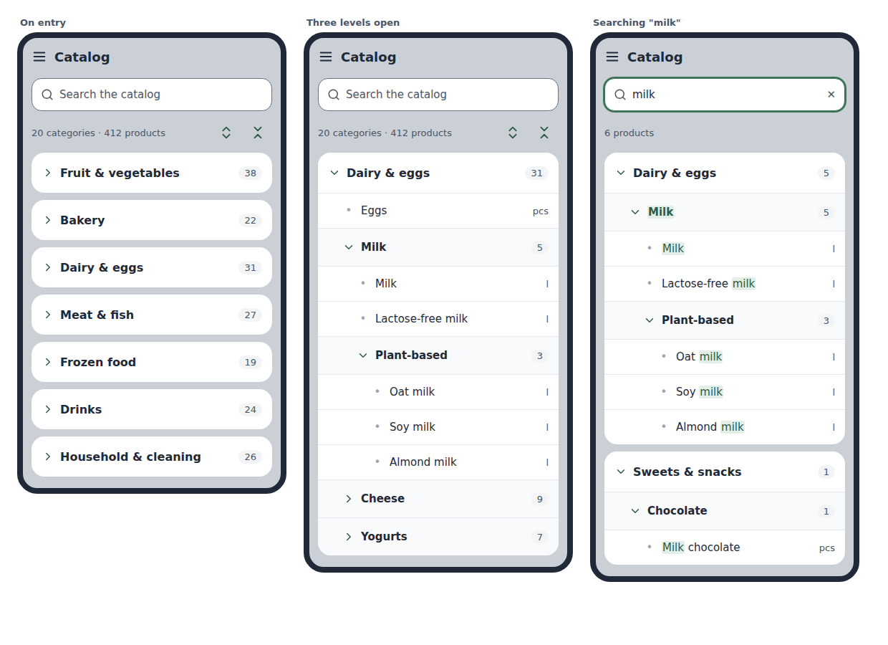
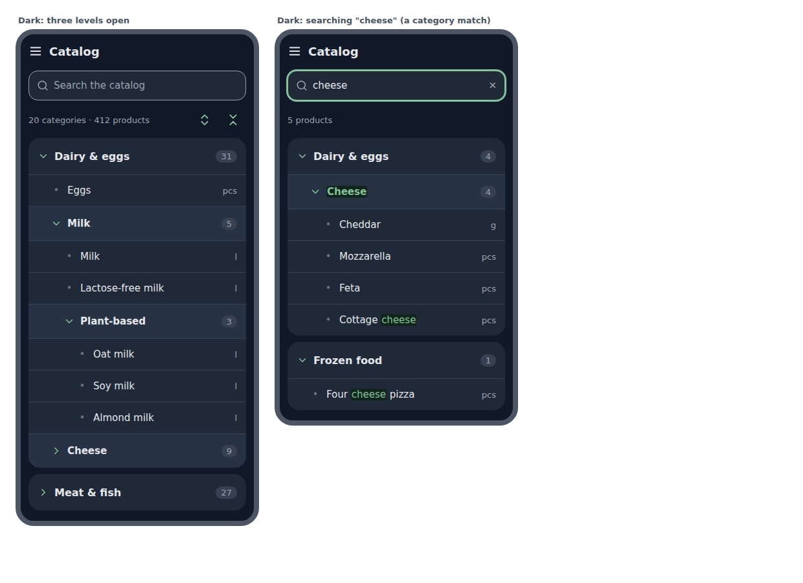
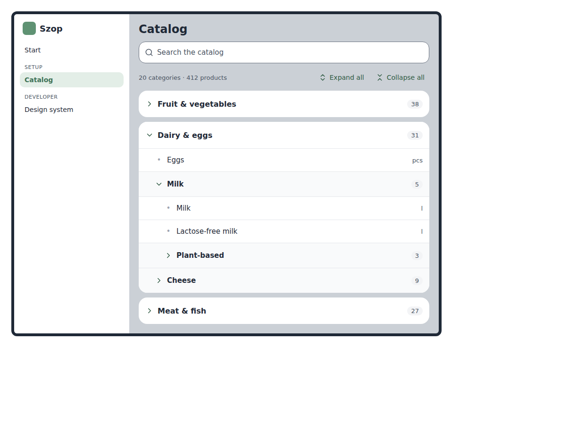

# PH-15a Seed catalog, read-only: design

The spec of [PH-15a](../../roadmap.md#ph-15a-seed-catalog-read-only). The decisions it settles go into ADR 0050 (Seed catalog phase details), written in the phase. This document holds the design they were taken from.

## Contents

- [Goal](#goal)
- [Changes to the roadmap](#changes-to-the-roadmap)
- [Decisions](#decisions)
- [Design](#design)
  - [The seed file](#the-seed-file)
  - [Loading and checking the seed](#loading-and-checking-the-seed)
  - [The shared schemas and the category order](#the-shared-schemas-and-the-category-order)
  - [The API](#the-api)
  - [The catalog page](#the-catalog-page)
  - [Search](#search)
  - [Documentation](#documentation)
- [Acceptance criteria](#acceptance-criteria)
- [Tests](#tests)
- [Definition of done for this phase](#definition-of-done-for-this-phase)
- [Order of work](#order-of-work)
- [Risks](#risks)
- [Out of scope](#out-of-scope)

## Goal

A visitor without a session opens **Catalog** in the menu and browses Szop's default catalog: about 20 top-level categories of a grocery and general store (like Lidl or Biedronka), each with 5 or 6 subcategories, and the products in them, in the store's order. The visitor can also search the catalog by name. Everything is read-only. The catalog is the seed data every workspace will start from ([ACC-1](../../requirements/ACC-accounts-and-guest-mode.md#acc-1)). It is kept in a YAML file that the owner edits by hand, and the API reads that file. No database tables are added.

This phase delivers [PRD-2](../../requirements/PRD-catalog.md#prd-2), the seed part of [ACC-1](../../requirements/ACC-accounts-and-guest-mode.md#acc-1), and the category order rule of [ORD-2](../../requirements/ORD-list-display-and-ordering.md#ord-2) and [ORD-3](../../requirements/ORD-list-display-and-ordering.md#ord-3) in `packages/shared`. It also brings fast-check, the API's JSON error shape ([OP-071](https://github.com/luiki-dev/szop/issues/94)), response serialization through the shared schemas ([OP-079](https://github.com/luiki-dev/szop/issues/96)), and the seed data tests ([OP-052](https://github.com/luiki-dev/szop/issues/93), its PH-15a part).

## Changes to the roadmap

- **PH-15 is split** into PH-15a Seed catalog, read-only ([#287](https://github.com/luiki-dev/szop/issues/287)) and PH-15b Mutation testing ([#288](https://github.com/luiki-dev/szop/issues/288)). With StrykerJS and `mutation.yml`, the phase held about ten tasks and two new concepts ([ADR 0014](../../decisions/0014-roadmap.md), decision 6). PH-15b follows at once and mutates the order rule and the seed checks this phase writes. This refines [ADR 0014](../../decisions/0014-roadmap.md), decision 7: fast-check arrives in PH-15a, StrykerJS and `mutation.yml` in PH-15b. Already done on GitHub and in `roadmap.md`.
- **The check that migrations match the schema ([OP-076](https://github.com/luiki-dev/szop/issues/95)) moves to [PH-16](../../roadmap.md#ph-16-guest-workspace-and-lists).** This phase adds no table ([decision 2](#decisions)). Already re-parented.
- **[OP-010](https://github.com/luiki-dev/szop/issues/63)'s fast-check part** is done here. The issue then moves to PH-15b for StrykerJS.

## Decisions

| # | Decision | Alternatives considered | Why |
|---|---|---|---|
| 1 | **The seed is a YAML file, nested the way the store is**: categories hold their products and their subcategories, and the order of categories in the file is the order in the store. Products are shown alphabetically, whatever their order in the file ([decision 12](#decisions)). There are no IDs and no `position` fields _(the owner asked for a human-editable standard format; YAML and the nested shape were Claude's proposal, which the owner approved)_. | JSON; TOML; CSV files; a TypeScript module. | JSON has no comments and fails on one stray comma. TOML writes three-level nested lists awkwardly. CSV needs extra columns to encode the tree and its order. A TypeScript module is code, not data. YAML's pitfalls (indentation, implicit types) are caught by YAML 1.2 parsing and a Zod check ([decision 3](#decisions)). |
| 2 | **The API reads the file; there are no tables** _(the owner's choice, on Claude's recommendation)_. | Seed tables in PostgreSQL loaded from the file; the file compiled into the SPA with no API. | A visitor without a workspace always sees the seed ([ACC-1](../../requirements/ACC-accounts-and-guest-mode.md#acc-1)), so this read path stays after PH-16. Seed tables would duplicate the per-workspace tables PH-16 creates. A compiled-in file would bypass the API contract and need rework when workspace data comes from the API. |
| 3 | **The file is parsed with the `yaml` package (YAML 1.2) and checked with a Zod schema at startup. A broken file stops the API from starting, with a message naming the entry** _(Claude's call)_. | `js-yaml`; serving whatever parses. | In YAML 1.2, `no` and `off` are plain strings, which avoids the "Norway problem". Failing at startup turns a bad edit into a failed deploy instead of a broken page, and the tests catch it before that. |
| 4 | **The catalog response is flat**: `categories` (`id`, `parentId`, `position`, `name`), `products` (`id`, `name`, `categoryId`, `unitId`), `units` (`id`, `name`). The same shape will serve a workspace's catalog later _(Claude's call)_. | The nested tree as in the file. | This is the shape the architecture gives the tables (`parent_id`, `position`). The shared order rule then works the same on the seed and on a workspace, and the client code will not change in PH-16. |
| 5 | **The category order is one pure function in `packages/shared`, tested with examples and with fast-check properties** _(the roadmap's plan)_. | Ordering in the API or in the page. | [ORD-2](../../requirements/ORD-list-display-and-ordering.md#ord-2) and [ORD-3](../../requirements/ORD-list-display-and-ordering.md#ord-3) are domain rules shared by the catalog now and the list in PH-17. Properties over random trees find edge cases that examples miss. |
| 6 | **The whole catalog comes in one request, and the page filters and expands it in the browser** _(Claude's call)_. | Search on the server, a request per keystroke. | About 500 products is a few tens of kB. Local filtering answers instantly, and offline reading ([NET-1](../../requirements/NET-connectivity.md#net-1)) gets easier later. |
| 7 | **Every API error uses one JSON shape**, `{ "error": { "code", "message" } }`, through `setErrorHandler` and a not-found handler for `/api/*`. The cross-site 403 and the JSON-only 415 move to it as well ([OP-071](https://github.com/luiki-dev/szop/issues/94)) _(Claude's call)_. | Leaving the 403 and 415 in Fastify's shape. | One shape for every error the browser can receive, as [architecture, Errors](../../architecture/architecture.md#errors) states. |
| 8 | **Responses are serialized through the shared Zod schemas with `fastify-type-provider-zod`** (its validator and serializer compilers, set once on the app) ([OP-079](https://github.com/luiki-dev/szop/issues/96)) _(Claude's call)_. | An explicit `schema.parse` in each route. | The contract is enforced by Fastify for every route that declares a schema, inputs included once routes take any, and the route types follow the schema. |
| 9 | **The page shows the tree with every category collapsible at every level, indented by level**. Category rows are set apart from product rows by a chevron, a bold name, a count pill and a tinted band. All categories start collapsed. "Expand all" and "Collapse all" are icon buttons on a phone and icon-and-label buttons from `lg` _(the owner's choices; the styling is Claude's, approved on the mockups)_. | Subcategories as small headings inside an open top-level card (the first mockup; rejected because they blended into the products, and the tree can be 5 levels deep). | The [mockups](#the-catalog-page). |
| 10 | **Search narrows the tree instead of showing a list of suggestions.** It matches product names and category names. Each match is shown with the path to it, opened, and the matched text highlighted. A matching category is shown on its path, collapsed, unless something inside it matches too _(the owner's choices; the last one changed at the review of the acceptance criteria, which replaced "a matching category shows its whole contents")_. | A dropdown of suggestions. | A dropdown would repeat the smart input of [PH-23](../../roadmap.md#ph-23-smart-input) and hide where a product lives. The same narrowed tree will serve the catalog browser of [PH-24](../../roadmap.md#ph-24-catalog-browser). |
| 11 | **The seed content is generated by Claude and then adjusted by the owner**: English, about 20 top-level categories with 5 or 6 subcategories each, a few typical products per subcategory (about 300 to 500 in total), a short list of units, and no default prices _(the owner's choices: language, store profile, counts, owner edits; no prices and the product count are Claude's calls)_. | Prices in the seed. | No single price is right for every store. |
| 12 | **Categories keep the file's order; products within a category are sorted alphabetically** _(the owner's choice)_. | Products in the file's order too, with a `position` on products. | Scanning a category by eye is easier alphabetically, and it matches how [ORD-2](../../requirements/ORD-list-display-and-ordering.md#ord-2) sorts list items. Products need no `position`, so the shape PH-16 builds tables from stays smaller. |
| 13 | **Names sort by Polish rules: `compareNames` uses `Intl.Collator("pl", { numeric: true })`** _(the owner's choice, on Claude's proposal)_. | English rules, with Polish left to PH-17a. | The rule is written once, in `packages/shared`, and the list in PH-17a sorts with it. Polish rules put "śmietana" between "ser" and "tofu" ([ORD-2](../../requirements/ORD-list-display-and-ordering.md#ord-2), criterion 2.3); English names sort the same way under both. This settles the sorting part of [OP-041](https://github.com/luiki-dev/szop/issues/100). |
| 14 | **A requirement's list of criteria is finalized by the phase that delivers its last part; an earlier phase reviews only the criteria it delivers** _(the owner's choice, on Claude's recommendation)_. | The rule of [ADR 0051](../../decisions/0051-acceptance-criteria.md), decision 15: the first phase that delivers any part reviews the whole list. | Lists such as [APP-1](../../requirements/APP-app-wide-behavior.md#app-1) and [NFR-4](../../requirements/NFR-non-functional-requirements.md#nfr-4) span phases up to PH-26; nobody can judge their later criteria without those phases' context, so "finalized" would promise what it cannot. No requirement reaches ✅ Done unfinalized, because the phase that delivers its last part finalizes it first. This refines ADR 0051, decision 15. In this phase only [PRD-2](../../requirements/PRD-catalog.md#prd-2) is finalized. |

## Design

### The seed file

**`apps/api/src/catalog/seed.yaml`** _(placing it under `src/` is Claude's call, because the Dockerfile already copies `apps/api/src` into the image)_. It starts with a comment saying what the file is, how it is structured, and that `pnpm test` checks it.

```yaml
# Szop's default catalog: the categories, products and units every
# workspace starts with (ACC-1). Categories are shown in this file's
# order, the store's order; products are shown alphabetically.
# The E2E test relies on "Dairy & eggs" and "Oat milk": rename them
# together with e2e/tests/catalog.spec.ts.
units: [pcs, kg, g, l, ml, pack]

categories:
  - name: Dairy & eggs
    products:
      - { name: Eggs, unit: pcs }
    subcategories:
      - name: Milk
        products:
          - { name: Milk, unit: l }
          - { name: Lactose-free milk, unit: l }
        subcategories:
          - name: Plant-based
            products:
              - { name: Oat milk, unit: l }
```

- `units`: a list of names. A product's `unit` names one of them. `unit` is optional; leaving it out means no default unit.
- A category has a `name`, and optionally `products` and `subcategories`. Products listed directly on a category come before its subcategories ([ORD-3](../../requirements/ORD-list-display-and-ordering.md#ord-3)). The order of products in the file carries no meaning: they are shown alphabetically ([decision 12](#decisions)).
- **The rules the check enforces** ([OP-052](https://github.com/luiki-dev/szop/issues/93); [LIM-1](../../requirements/LIM-limits.md#lim-1), [LIM-2](../../requirements/LIM-limits.md#lim-2)): at most 300 categories, nesting at most 5 levels deep, at most 2,000 products, at most 50 units; names at most 100 characters, trimmed and not empty; units unique; category names unique across the whole tree, case-insensitive, so that matching by name ([ACC-4](../../requirements/ACC-accounts-and-guest-mode.md#acc-4)) is unambiguous; product names unique, case-insensitive; every `unit` named in `units`; no unknown keys. These rules apply to the seed only. Whether a workspace enforces the same uniqueness is for [PH-26](../../roadmap.md#ph-26-catalog-and-units) and [PH-27](../../roadmap.md#ph-27-categories) _(Claude's call)_.
- **The content** ([decision 11](#decisions)): Claude writes the first version in this phase. The owner edits it afterwards, in this PR or later.

### Loading and checking the seed

`apps/api/src/catalog/seed.ts`:

- `parseSeed(text: string): Catalog` parses the text with `yaml` (YAML 1.2 core schema, duplicate keys rejected), checks it with a Zod schema of the file's shape, applies the uniqueness and reference rules, and turns the tree into the flat [catalog response](#the-shared-schemas-and-the-category-order). `position` is the index among siblings. IDs are strings assigned in file order (for example `c1`, `p1`, `u1`; the exact scheme is the builder's call). They are stable for one version of the file, which is all a read-only catalog needs. PH-16 gives workspace rows their own IDs.
- Errors name the entry and the rule, for example `categories › Dairy & eggs › Milk: the name "Milk" is used twice`, or the YAML line for a syntax error.
- `loadSeed()` reads the file next to the module and calls `parseSeed`. `server.ts` calls it once at startup and passes the result to `buildApp` as a new dependency, `catalog`. Tests pass their own small catalog (ADR 0007, decision 14). A failure is logged and exits with a non-zero code, as a bad config does today.

### The shared schemas and the category order

In `packages/shared/src/catalog.ts`:

- **`catalogSchema`**, the body of `GET /api/catalog`. `categories`: `{ id, parentId: string | null, position: int ≥ 0, name }`. `products`: `{ id, name, categoryId: string | null, unitId: string | null }`. `units`: `{ id, name }`. Names are at most 100 characters ([LIM-2](../../requirements/LIM-limits.md#lim-2)). Product prices join with [PH-26](../../roadmap.md#ph-26-catalog-and-units).
- **`orderCategories(categories)`** returns every category once, depth-first: each parent before its subcategories, and siblings by `position`, then by name for ties. Each entry carries its `depth`, starting at 0. This is the "global category order" of [ORD-2](../../requirements/ORD-list-display-and-ordering.md#ord-2). A category whose parent is missing, or which sits in a cycle, cannot come from the seed, but the function must still terminate. The builder decides whether such a category is dropped or treated as a top-level one, and documents the choice in the function's comment.
- **fast-check properties**, over random forests of up to about 50 categories with shuffled input order: the output is a permutation of the input; every category comes after its parent; a parent's whole subtree is contiguous and directly follows it; siblings follow `position` order; `depth` equals the number of ancestors; and the result does not depend on the input's order. Example tests cover the empty list, one level, ties in `position`, and the five-level case.

### The API

- **`GET /api/catalog`** in `apps/api/src/catalog/routes.ts`, a plugin like `healthRoutes`, registered under `/api`. It is public: there are no sessions yet, and reading the seed changes nothing. It answers 200 with the catalog, with its response schema declared, so `fastify-type-provider-zod` serializes it ([decision 8](#decisions)). The validator and serializer compilers are set in `buildApp`. The health route declares its schema too, so both routes follow the same pattern. Whether health's 503 body goes through the serializer is the builder's call, recorded in the ADR. HTTP caching (`ETag`, `Cache-Control`) is left out: the browser fetches the catalog once per visit.
- **The error shape** ([OP-071](https://github.com/luiki-dev/szop/issues/94); [architecture, Errors](../../architecture/architecture.md#errors)): `setErrorHandler` maps validation errors to 400 `invalid_input`, errors that carry a 4xx `statusCode` to their status with a code in snake case, and anything else to 500 `internal_error`. The 500 is logged with the error, and its message is generic. `webRoutes`' not-found handler answers API paths and missing files with 404 `not_found` in the new shape, instead of copying Fastify's body. The cross-site 403 becomes `forbidden_cross_site` and the 415 becomes `unsupported_media_type` (the builder may refine the codes). `packages/shared` gets an `apiErrorSchema` the web client can parse.
- **`architecture.md`'s Errors table** stays the reference. The codes used so far are listed under it.

### The catalog page

The approved mockups, with Ring tail tokens:





In this mockup the matching category Cheese shows its whole contents. The review of the acceptance criteria changed that: a matching category stays collapsed unless something inside it matches too ([Search](#search)).



- **Route and menu:** `/catalog`, titled "Catalog", in `apps/web/src/catalog/`. The menu gains a "Setup" heading with Catalog under it, above "Developer" ([visual-design, section 5](../../architecture/visual-design.md#5-layout-and-navigation)). The Start page gets no link: the menu is the navigation.
- **Data:** `getCatalog()` in `api/client.ts` parses the response with `catalogSchema`. A TanStack Query hook keeps the result for the session; the catalog changes only with a deploy. The page builds its tree once from `orderCategories` and the products grouped by `categoryId`. Products sort by name within their category ([decision 12](#decisions)), with a shared `compareNames` in `packages/shared` (`Intl.Collator("pl", { numeric: true })`, [decision 13](#decisions); further options are the builder's call), so the list in PH-17 sorts the same way. The mockups show products in file order; the built page sorts them.
- **Above the tree:** the search field ([Search](#search)), then a line with "20 categories · 412 products" (top-level categories and all products, from the data) and the two buttons, "Expand all" and "Collapse all", using Lucide's `ChevronsUpDown` and `ChevronsDownUp`. On a phone the buttons show only their icons, with the names as `aria-label` and a tooltip. From `lg` they show the icon and the label.
- **The tree:**
  - Each top-level category is a white `card` with rounded corners, as in the list screen.
  - **A category row** (56 px at the top level, 52 px below it) is one button showing a chevron (right when closed, down when open, in `link` color), the name in semibold, and a pill with the number of products in its whole subtree. Rows below the top level have a tinted band: a new `muted` background role, light about `gray-50`, dark between `gray-800` and `gray-700`. The exact steps are the builder's, with contrast checked and added to the token contrast test.
  - **A product row** (48 px) shows a small bullet in a muted color, the name in regular weight, and the default unit on the right in `muted-foreground`, or nothing if the product has none.
  - Each level is indented by 20 px. Within an open category, its products come first, then its subcategories. Rows are divided by `border`. Long names wrap to a second line rather than being cut.
- **Accessibility:** the disclosure pattern rather than an ARIA tree: each category row is a `<button aria-expanded>` controlling the list below it, and the lists are nested `<ul>`s. The button's accessible name includes the count, for example "Dairy & eggs, 31 products" _(Claude's call: the disclosure pattern needs no arrow-key model and reads well on every screen reader)_.
- **Expansion state** lives in the page (a set of open category IDs). It is not kept across visits. Collapsing a category keeps what was open inside it, so opening it again restores that. "Expand all" opens every category at every level, and "Collapse all" closes all of them.
- **States:** loading shows skeleton cards shaped like the collapsed list. On an error, a card says the catalog could not be loaded and offers "Try again", which refetches. A long, 40-character product name wraps. Dark mode follows the tokens. Offline is not handled in this phase ([NET-1](../../requirements/NET-connectivity.md#net-1) comes in [PH-22](../../roadmap.md#ph-22-offline-state)).

### Search

- **The field:** a search input (`type="search"`, inside a `role="search"` landmark) with a magnifier icon, the placeholder "Search the catalog", the accessible name "Search the catalog", and a ✕ button to clear it. It has no visible label: this is a second exception to "labels are always visible", like the add bar ([ADR 0022](../../decisions/0022-ring-tail-redesign.md), decision 13), recorded in the ADR and in [visual-design.md](../../architecture/visual-design.md#forms-and-focus) _(Claude's call)_. Esc clears it as well.
- **Matching:** the query is trimmed. Matching is case-insensitive and accent-insensitive (Unicode NFD with the combining marks removed) and finds a substring anywhere in the name. An empty query shows the normal tree. The filter runs as the user types; no debounce is needed at this size.
- **What is shown:**
  - A matching product is shown under the path of its categories, every one opened.
  - A matching category is shown on its path, collapsed, with its name highlighted. If something inside it matches too, it is opened and shows only those matches. Opened by hand during the search, it shows its whole contents.
  - Everything else is hidden.
  - Counts in the pills, and the line above the tree ("6 products"), count what is shown.
  - The matched text is highlighted with a `<mark>` in `accent` / `accent-foreground`.
- **Toggling during search:** while a query is active, "Expand all" and "Collapse all" are hidden, but category rows still toggle. The search keeps its own expansion state: every change of the query opens the paths to its matches again, discarding the user's toggles made under the previous query _(Claude's call: one simple rule, and a new query always shows all its matches)_.
- **Leaving search:** clearing the field restores the browsing expansion state from before the search, untouched by toggles made while searching.
- **No match:** "No products match "xyz"" in a card. The page offers no further action: nothing can be added in this phase.
- **Requirements:** [PRD-2](../../requirements/PRD-catalog.md#prd-2)'s wording became "Browse the catalog by category, and search it by product or category name." at the review of the acceptance criteria ([Acceptance criteria](#acceptance-criteria)).

### Documentation

- **ADR 0050** (Seed catalog phase details): the decisions above. `Refines:` [ADR 0014](../../decisions/0014-roadmap.md), decision 7 (the PH-15 split), [ADR 0022](../../decisions/0022-ring-tail-redesign.md), decision 13 (the search field's label), and [ADR 0051](../../decisions/0051-acceptance-criteria.md), decision 15 (who finalizes a list of criteria, [decision 14](#decisions)), with the notes in those ADRs.
- **[architecture.md](../../architecture/architecture.md):** Seed data (YAML, its location, loaded at startup, no tables until PH-16); Errors (the codes in use, the handler); the API's code structure (`catalog/`); the web's routes table (`/catalog` exists now); the serializer.
- **[visual-design.md](../../architecture/visual-design.md):** the tree pattern (category and product rows, indent, counts, expand and collapse), the `muted` role in the color table, the search-field exception, and the catalog mockups as the reference for later tree screens ([PH-24](../../roadmap.md#ph-24-catalog-browser), [PH-27](../../roadmap.md#ph-27-categories)).
- **[stack-overview.md](../../architecture/stack-overview.md):** YAML and why it is checked with Zod; property-based testing; Fastify type providers and serialization.
- **[testing.md](../../development/testing.md):** property tests (when to write them, where they live, how to read a counterexample and replay a seed); the seed data tests.
- **`docs/development/tools/fast-check.md`**: the new tool page. `yaml` and `fastify-type-provider-zod` are libraries, not development tools, so they get no page; the builder checks whether earlier library choices got pages and follows that.
- **The requirements:** the criteria this phase delivers marked ✅ with their tests ([Acceptance criteria](#acceptance-criteria)), each requirement's line and the index updated. The rule of [decision 14](#decisions) written into the index's "How phases change criteria" and "✅ Criteria finalized", and into `CLAUDE.md`'s step "During the brainstorm".
- **[threat-model.md](../../architecture/threat-model.md):** `GET /api/catalog` as a new public entry point that only reads data, with nothing to guard beyond the baseline. Rate limiting arrives in [PH-20](../../roadmap.md#ph-20-quotas-and-rate-limits).
- **[scripts.md](../../development/scripts.md):** only if a script changes.
- **[glossary.md](../../glossary.md):** any niche term the new docs use (for example YAML, property-based testing).
- **`roadmap.md`:** the PH-15a row's Spec, Plan and PR links, and its **Delivers** if anything changes.

## Acceptance criteria

Reviewed with the owner on 2026-10-27, after the merge of [PH-40](../../roadmap.md#ph-40-acceptance-criteria). Each criterion below is 🚧 [PH-15a](../../roadmap.md#ph-15a-seed-catalog-read-only) in the requirements. The PR marks each one ✅, with a test whose name starts with its ID ([testing.md](../../development/testing.md#rules)), except where it says the criterion stays 🚧.

| Requirement | Criteria | Task | Notes |
|---|---|---|---|
| [PRD-2](../../requirements/PRD-catalog.md#prd-2) | 2.1 to 2.12, the whole list, ✅ Criteria finalized ([decision 14](#decisions)) | 5 and 6 (2.6, 2.7, 2.10 to 2.12 in 6), 7 for E2E | Added at the review: 2.10 (case and accents), 2.11 (clearing restores the expansion), 2.12 (no match). 2.7 changed: a matching category stays collapsed. |
| [ORD-2](../../requirements/ORD-list-display-and-ordering.md#ord-2) | 2.1, 2.2, 2.3 | 1 | The rule in `packages/shared`, tested here; the criteria stay 🚧 until the list uses it in [PH-17a](../../roadmap.md#ph-17a-list-items). 2.3 by [decision 13](#decisions). |
| [ORD-3](../../requirements/ORD-list-display-and-ordering.md#ord-3) | 3.1 | 1 | As for ORD-2: stays 🚧 until PH-17a. In the catalog, products also come before subcategories ([PRD-2](../../requirements/PRD-catalog.md#prd-2).5). |
| [ACC-1](../../requirements/ACC-accounts-and-guest-mode.md#acc-1) | 1.2, 1.3 | 4 and 5 | 1.2: the seed catalog, read-only; stays 🚧 until [PH-16](../../roadmap.md#ph-16-guest-workspace-and-lists). 1.3: `GET /api/catalog` sets no cookie; ✅ as a general rule that later read routes keep true. |
| [APP-1](../../requirements/APP-app-wide-behavior.md#app-1) | 1.9 | 5 | The Setup heading, with Catalog under it. ✅ as a general rule. |
| [APP-4](../../requirements/APP-app-wide-behavior.md#app-4) | 4.1, 4.3 | 5 | The catalog's skeleton and "Try again". ✅ as general rules. |
| [NFR-4](../../requirements/NFR-non-functional-requirements.md#nfr-4) | 4.11 | 3 | The error handler's 500 with a generic message. |

The lists of [ACC-1](../../requirements/ACC-accounts-and-guest-mode.md#acc-1), [ORD-2](../../requirements/ORD-list-display-and-ordering.md#ord-2), [ORD-3](../../requirements/ORD-list-display-and-ordering.md#ord-3), [APP-1](../../requirements/APP-app-wide-behavior.md#app-1), [APP-4](../../requirements/APP-app-wide-behavior.md#app-4) and [NFR-4](../../requirements/NFR-non-functional-requirements.md#nfr-4) stay ❔ Criteria not finalized ([decision 14](#decisions)).

## Tests

- **Shared (Vitest, fast-check):** `catalog.test.ts`: the example tests and the properties of `orderCategories`; `compareNames` (case, accents, numbers such as "Pack 2" before "Pack 10"; Polish order, "ser" < "śmietana" < "tofu"); `catalogSchema` accepts a valid body and rejects a name of 101 characters.
- **API, unit (Vitest):**
  - `seed.test.ts` runs `parseSeed` on small YAML strings: a valid file; each broken rule (a duplicate category name in any case, a duplicate product, an unknown unit, depth 6, an empty name, a name of 101 characters, an unknown key, a duplicate YAML key, a syntax error) with the message checked; a key such as `no` read as the string "no".
  - **The real file** ([OP-052](https://github.com/luiki-dev/szop/issues/93)): `loadSeed()` succeeds; the [LIM-1](../../requirements/LIM-limits.md#lim-1) quotas hold; and the test prints how much of each quota the seed uses (categories of 300, products of 2,000, units of 50, the deepest level of 5), so the PR can state it.
- **API, routes (Vitest with `app.inject`, as the health tests do):** `GET /api/catalog` answers 200 with a body that `catalogSchema` accepts; a body that breaks the schema (from a fake catalog that the test builds wrongly on purpose) gives a 500 in the error shape and is not sent as is; `GET /api/nope` gives 404 `not_found` in the error shape; the 403 and 415 cases of the security plugins give the new shape; an error thrown in a route gives 500 `internal_error` with a generic message, and the log line carries the error.
- **Web (Vitest, Testing Library, MSW):**
  - `catalog-page.test.tsx` through the real route table, with an MSW handler serving a small catalog: the loading skeleton, then the collapsed top-level categories with their counts; opening a category shows its products first, then its subcategories; "Expand all" and "Collapse all"; collapsing and reopening a parent keeps a child open; the error card and "Try again"; the menu shows Catalog under Setup.
  - Products in an open category are in alphabetical order.
  - The search: a product match shows its path; toggling a row while searching, then changing the query, opens the matches again; a category match stays collapsed, opens to show only the matches inside it, and opened by hand shows its whole contents; accent- and case-insensitive matching; the highlight; "No products match"; clearing restores the expansion state; Esc clears.
  - `@testing-library/user-event` joins here if the clicks and typing need it ([OP-080](https://github.com/luiki-dev/szop/issues/104) planned it for the first phase with interactions). The builder checks that issue and closes it or leaves it, as fits.
- **E2E (Playwright, every project):** `e2e/tests/catalog.spec.ts` runs against the real API and the real seed file. It relies on two entries, "Dairy & eggs" and "Oat milk", which the seed's header comment names, so editing the seed stays free apart from those two _(Claude's call)_. It opens Catalog from the menu (through ☰ on the phone project), opens "Dairy & eggs" and checks a product, searches "oat milk" and sees it under its path (Dairy & eggs › Milk › Plant-based in the generated seed; the test checks the product and its top-level category, not every level), clears the search, and runs `expectAccessible` in light and dark. The token contrast test gains the new `muted` pairs.
- **The first-screen budget** (200 KB Brotli) keeps passing. The catalog page is lazy-loaded if the budget needs it (the builder's call).
- **By hand:** the PR's screenshots (phone light and dark, desktop light: collapsed, opened, searching), and a look in Firefox.

## Definition of done for this phase

The shared [definition of done](../../development/definition-of-done.md) applies. In particular: CI green; the PR shows the screenshots above and the seed's quota usage; the demo check after `demo-up` on the branch confirms the catalog on a phone and a desktop, search, and no CSP errors in the console. No owner steps beyond the usual demo check. Editing the seed content is the owner's choice, not a step the phase waits for.

## Order of work

About seven tasks, each one commit:

1. **The shared catalog**: `catalogSchema`, `orderCategories`, fast-check with its example and property tests; the fast-check tool page and the property-test section of `testing.md`.
2. **The seed**: `yaml`, `parseSeed` and `loadSeed` with their tests, the generated `seed.yaml`, the real-file test with the quota report, and `server.ts` passing the catalog to `buildApp`.
3. **The error shape**: the error handler, the API not-found answer, the 403 and 415 in the new shape, `apiErrorSchema`; tests.
4. **The catalog route**: `fastify-type-provider-zod` set up, `GET /api/catalog` and the health route declaring their schemas; tests.
5. **The catalog page**: the route, the menu's Setup heading, the client and the query, the tree with expand and collapse, the loading and error states, the `muted` role; tests.
6. **Search**: the field, the matching, the narrowed tree, the highlight, no match, restoring the expansion; tests.
7. **E2E and documentation**: `catalog.spec.ts` and the contrast pairs; ADR 0050 with its notes, architecture.md, visual-design.md, stack-overview.md, testing.md, the requirements, the threat model, the glossary, and the roadmap.

## Risks

- **`fastify-type-provider-zod` and Zod 4.** The provider must support the Zod version in use. The plan checks the current release before naming APIs. If it does not fit, the fallback is an explicit `catalogSchema.parse` in the route ([OP-079](https://github.com/luiki-dev/szop/issues/96) allows either), recorded in the ADR.
- **A seed edit that breaks the file** is caught by the real-file test in CI. If it ever reached a running API, the API would refuse to start, and the deploy's health check would stop the rollout.
- **Generated content that reads oddly** (product names, units). The owner reviews `seed.yaml` in the PR. The file is meant to be edited.
- **A long page** with every category open (about 140 category rows and 500 product rows) on a slow phone. Rendering 650 rows is fine for React. If "Expand all" is visibly slow, the builder measures before adding anything such as virtualization, which is out of scope.

## Out of scope

- Adding, editing, deleting or moving anything in the catalog ([PRD-1](../../requirements/PRD-catalog.md#prd-1), [CAT-1](../../requirements/CAT-categories.md#cat-1), [UNT-1](../../requirements/UNT-units.md#unt-1): [PH-26](../../roadmap.md#ph-26-catalog-and-units) and [PH-27](../../roadmap.md#ph-27-categories)), and adding products to a list from the catalog ([PH-24](../../roadmap.md#ph-24-catalog-browser)).
- Database tables, migrations and the migration check ([OP-076](https://github.com/luiki-dev/szop/issues/95), [PH-16](../../roadmap.md#ph-16-guest-workspace-and-lists)).
- Default prices in the seed; a Polish catalog.
- Separate `/categories` and `/units` pages.
- HTTP caching of the catalog; rate limiting ([PH-20](../../roadmap.md#ph-20-quotas-and-rate-limits)).
- Keeping the expansion state across visits.
- StrykerJS and `mutation.yml` ([PH-15b](../../roadmap.md#ph-15b-mutation-testing)).
