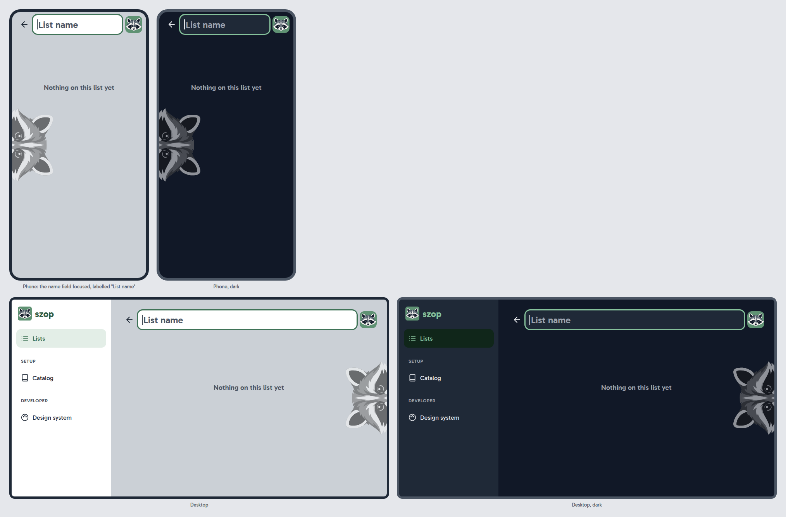

# PH-16a Guest's first list: design

## Contents

- [Goal](#goal)
- [Decisions](#decisions)
- [The design](#the-design)
  - [The data model](#the-data-model)
  - [Better Auth](#better-auth)
  - [The first change](#the-first-change)
  - [The access layer](#the-access-layer)
  - [The API](#the-api)
  - [The screens](#the-screens)
  - [Sending changes from the SPA](#sending-changes-from-the-spa)
  - [The migration check](#the-migration-check)
  - [The demo](#the-demo)
- [Acceptance criteria](#acceptance-criteria)
- [Tests](#tests)
- [Documentation](#documentation)
- [Demo check](#demo-check)
- [Risks](#risks)
- [Out of scope](#out-of-scope)
- [Left to the builder](#left-to-the-builder)

## Goal

A visitor creates their first list, which gives them an anonymous session and an empty workspace; they see their lists on the home screen, newest first, open one and rename it, and nobody else can reach them ([PH-16a](../../roadmap.md#ph-16a-guests-first-list)).

## Decisions

[ADR 0057](../../decisions/0057-guests-first-list-phase-details.md#decisions).

## The design

### The data model

The first tables. The conventions of [ADR 0057](../../decisions/0057-guests-first-list-phase-details.md), decision 14, hold for each of them and for every later table:

- tables plural and `snake_case`, columns `snake_case`, fields `camelCase` in TypeScript;
- `created_at` and `updated_at`, both `timestamptz NOT NULL DEFAULT now()`, with Drizzle's `$onUpdate` setting `updated_at`;
- IDs `uuid`, defaulting to `uuidv7()` where the server creates the record;
- constraints named explicitly, in PostgreSQL's style (`<table>_pkey`, `<table>_<columns>_key`, `<table>_<columns>_fkey`).

| Table | Columns | Keys |
|---|---|---|
| `users`, `sessions`, `accounts`, `verifications` | Better Auth's, with the anonymous plugin's `is_anonymous` on `users`; generated once by Better Auth's CLI as Drizzle schema, then owned by us | Better Auth's, with `uuid` IDs |
| `workspaces` | `id`, `user_id`, `created_at`, `updated_at` | `workspaces_pkey (id)`; `workspaces_user_id_key UNIQUE (user_id)`; `workspaces_user_id_fkey → users (id) ON DELETE CASCADE` |
| `lists` | `workspace_id`, `id` (from the browser), `name` (`text NOT NULL`), `created_at`, `updated_at` | `lists_pkey (workspace_id, id)`; `lists_workspace_id_fkey → workspaces (id) ON DELETE CASCADE`; an index for the lists page, `(workspace_id, created_at DESC)` |

- `name` is at most 100 characters ([LIM-2](../../requirements/LIM-limits.md#lim-2).1), checked by the shared schema; a `CHECK` in the database is the builder's call.
- `workspaces` has no `last_active_at` yet: the session's sliding end measures a guest's activity for now ([ADR 0057](../../decisions/0057-guests-first-list-phase-details.md), decision 11), and the cleanup of [PH-31](../../roadmap.md#ph-31-automatic-cleanup) decides whether it needs one.
- One migration generated by `pnpm db:generate` after `0000_init`.

### Better Auth

- **Packages:** `better-auth` in `apps/api`, at the latest version; the client part (`better-auth/client` with the anonymous plugin's client) in `apps/web`.
- **Mounted** on Fastify under `/api/auth/*`, through a route that turns the Fastify request into a web `Request` and Better Auth's `Response` back. The web baseline (cross-site check, JSON only, headers) runs before it, as for every route.
- **Configuration:**
  - the Drizzle adapter (`provider: "pg"`), with the tables mapped by `modelName` to `users`, `sessions`, `accounts`, `verifications`;
  - `advanced.database.generateId: "uuid"`: on PostgreSQL Better Auth leaves the ID to the database's `uuidv7()` default. If it sends an ID of its own instead (a v4), `generateId` becomes a function returning a UUIDv7, the same generator the SPA uses, so every ID is a v7 either way _(Claude's call)_;
  - `session: { expiresIn: 30 days, updateAge: 1 day }`, no `cookieCache`;
  - the anonymous plugin only; email and password are not enabled (PH-18);
  - `trustedOrigins` exactly the app's origin ([ADR 0012](../../decisions/0012-security-baseline.md), decision 7);
  - the cookie: `HttpOnly`, `Secure`, `SameSite=Lax`, no `Domain`, the `__Host-` prefix if Better Auth allows it, otherwise `__Secure-` ([NFR-4](../../requirements/NFR-non-functional-requirements.md#nfr-4).9). `Secure` and the prefix follow the origin's scheme, as Better Auth does by default: on `https` (the demo) they are set; on the plain `http` of development (`http://localhost:5173` through Vite's proxy) and of the E2E server (`http://127.0.0.1:3100`) the cookie has neither, so it works in every browser there _(Claude's call)_. The API test of the attributes runs with an `https` origin;
  - no `databaseHooks` that create anything ([ADR 0057](../../decisions/0057-guests-first-list-phase-details.md), decision 13).
- **Configuration from the environment:** `BETTER_AUTH_SECRET` (required, at least 32 characters) and the app's public origin (a new variable such as `APP_ORIGIN`, the builder's name), added to `config.ts`, `.env.example` and the test config.

### The first change

1. The visitor presses Enter in the name field of a new list.
2. The SPA asks Better Auth for the session it holds. With none, it calls `POST /api/auth/sign-in/anonymous`, which sets the cookie.
3. The SPA sends `POST /api/lists { id, name }`, the ID a UUIDv7 it generated.
4. In one transaction, the server finds or creates the user's workspace (`ownWorkspace` for writing) and inserts the list.

A guest whose step 3 fails keeps a session without a workspace; the next change creates it ([ADR 0057](../../decisions/0057-guests-first-list-phase-details.md), decision 13). Two tabs making their first change at the same moment can still create two guests; that is [ACC-1](../../requirements/ACC-accounts-and-guest-mode.md#acc-1).6, in [PH-16b](../../roadmap.md#ph-16b-workspace-from-the-default-data).

### The access layer

As in [ADR 0012](../../decisions/0012-security-baseline.md), decisions 3 to 5, built for one table:

- **The auth hook:** a `preHandler` on the API's routes asks Better Auth for the session and sets `request.user` to the user or `null`. It never creates anything.
- **`ownWorkspace`**, in two forms, returning the context `{ user, workspaceId, role: "owner" }`:
  - for reading: the user's workspace, or none when the user or the workspace is missing (the lists page is then empty);
  - for writing: requires a user (otherwise 401), then finds or creates the workspace with `INSERT … ON CONFLICT (user_id) DO NOTHING` followed by a read, so two racing writes share one workspace.
- **`requireListAccess(user, listId)`:** the list's workspace and the role `owner` when the list is in the user's workspace, otherwise 404.
- **Services never read the session**; they get the context. **The list repository** takes `workspaceId` in every function; there is no lookup by ID alone.

The names and the file layout follow the catalog module of PH-15a; the exact signatures are the builder's.

### The API

All bodies are serialized through schemas in `packages/shared`; errors use the one JSON shape ([ADR 0050](../../decisions/0050-seed-catalog-phase-details.md), decision 7).

| Route | Does | Answers |
|---|---|---|
| `GET /api/lists` | The workspace's lists, newest first (`created_at DESC`, then `id DESC`) | 200 `{ lists: [{ id, name, createdAt }] }`; an empty array without a session or workspace |
| `POST /api/lists` | Body `{ id, name }`: `id` a UUID, `name` trimmed, NFC, 1 to 100 characters | 201 with the list; 200 with the existing list when the ID is already in this workspace, whatever the name ([ADR 0057](../../decisions/0057-guests-first-list-phase-details.md), decision 15); 401 without a session; 400 for an invalid body |
| `GET /api/lists/:id` | One list | 200; 404 when it is not in the caller's workspace or does not exist, the same answer ([NFR-4](../../requirements/NFR-non-functional-requirements.md#nfr-4).10) |
| `PATCH /api/lists/:id` | Body `{ name }`, checked as above; an unchanged name writes nothing and leaves `updated_at` | 200 with the list; 404 as above, also without a session; 400 |

- **Without a session**, reads answer as for a workspace with no lists, and set no cookie ([ACC-1](../../requirements/ACC-accounts-and-guest-mode.md#acc-1).3).
- `GET /api/lists/:id` without a session answers 404, like `PATCH`: only `POST` needs a session to exist, so only it answers 401 _(Claude's call)_.
- A name's length counts Unicode code points, as PostgreSQL's `char_length` does, so an emoji counts as one character _(Claude's call)_.
- A list ID that is not a UUID in the path answers 404, not 400, so a malformed ID tells nothing more than a missing one.
- A create with an ID that exists in another workspace inserts a new list, since the key is `(workspace_id, id)`.
- The shared schemas: `listSchema`, `createListSchema`, `renameListSchema`, `listNameSchema` (the trim, NFC and the 100-character limit, used by the forms too, [LIM-2](../../requirements/LIM-limits.md#lim-2).2).

### The screens

The three screens were drawn as mockups and approved in a session of their own before the plan, on a phone and on a desktop from `lg`, light and dark ([ADR 0057](../../decisions/0057-guests-first-list-phase-details.md), decision 20). The plan builds the screens as the mockups show them; the mockups are drawings, so the tokens and this text win over their pixels. They stay next to this spec: they are not final designs, and the screens of the phases that change the design move to `docs/architecture/visual-design/` together after the last of them _(the owner's choice, [OP-113](https://github.com/luiki-dev/szop/issues/316))_.





**The lists page, `/`** (the home screen; replaces the Start page, and "Lists" replaces "Start" in the menu; `apps/web/src/start/` is removed, and the tests and journeys that open Start are rewritten for the lists page):

- with lists: one card per list, newest first, showing only the name, cut with "…" when too long; a card is a link to `/lists/:id` and has no other action;
- the content column is the shell's, at most 720 px and centered; a long name never widens it (`min-w-0` on the column and the card);
- with no list: the raccoon and "Create your first list", centered, in the "Soft" greys: the raccoon in grayscale at 55% opacity, the text in `muted-foreground` at 20 px semibold (4.9:1 on the light page). Lighter text would fail [NFR-2](../../requirements/NFR-non-functional-requirements.md#nfr-2)'s contrast;
- "+ New list": pinned at the bottom on a phone, in the page's header from `lg`, as on [the navigation mockup](../../architecture/visual-design/navigation.png); a sticky bar never covers the focused element ([APP-1](../../requirements/APP-app-wide-behavior.md#app-1).8);
- states: loading (skeleton cards in `card`, pulsing with `motion-safe:animate-pulse` as on the catalog page), failing to load (the error card with "Try again", as on the catalog page), empty, long names, dark mode.

**A new list, `/lists/new`:**

- the list screen's header with ←, the name field, focused, and the raccoon tile; no ⋮, since there is nothing to rename yet _(Claude's call)_;
- the field has the placeholder "List name" and the same accessible name, with no visible label: the third exception to "labels are always visible", after the add bar and the catalog's search, since a label would push the header down _(Claude's call)_;
- the body is the empty list's ("Nothing on this list yet" and the peeking raccoon), so only the address changes when Enter creates the list _(Claude's call)_;
- Enter with a valid name creates the list (see [Sending changes from the SPA](#sending-changes-from-the-spa)) and replaces the address with `/lists/<id>` without a new history entry, so ← and Back return to the lists page;
- Esc, or leaving with ← while the name is empty, returns to the lists page and stores nothing; Enter with an empty name does nothing;
- a name over 100 characters is refused before sending, with a message ([LIM-2](../../requirements/LIM-limits.md#lim-2).2).

**A list, `/lists/:id`:**

- the header: ← back to the lists page in place of ☰ ([APP-1](../../requirements/APP-app-wide-behavior.md#app-1).6), the name, a ⋮ menu whose one item is "Rename", and the raccoon tile in the corner, ⋮ just before it;
- the name is an editable field: a click or "Rename" focuses it; Enter or leaving the field saves a changed, valid name; Esc puts the old name back; an empty name is not saved;
- the field at rest reads as the title (Gabarito 800, cut with "…"), with a dotted 2 px underline in `input` as the only hint that it can be changed; focused, it becomes a `card` field with `rounded-control` corners and the 3 px `ring`. The same field is the name field of a new list;
- the body: "Nothing on this list yet" in `muted-foreground`, and the raccoon peeking in, in the "Soft" greys of the lists page: the top of its head, cut 5 px (at a 200 px head) below its eyes. On a phone it peeks in from the left edge, halfway down, turned 90° to the right, so [PH-17a](../../roadmap.md#ph-17a-items-on-a-list)'s add bar at the bottom does not cover it; from `lg` it peeks in from the content area's right edge, turned 90° to the left. Decorative, hidden from screen readers;
- a list that is not found (another workspace's, or deleted elsewhere) shows the not-found state of the catalog's error card pattern with a link to the lists page; the app-wide not-found page is [PH-16c](../../roadmap.md#ph-16c-managing-lists)'s;
- the page's title in the tab is the list's name ("Weekly shop · Szop").

### Sending changes from the SPA

- TanStack Query mutations for creating and renaming, with `networkMode: 'always'`, so a change made offline fails at once instead of waiting in a queue ([NET-1](../../requirements/NET-connectivity.md#net-1)).
- **Not optimistic in this phase:** the field shows that it is saving and the screen updates from the server's answer; on success the lists query is updated or invalidated. A failure shows a short message next to the field and keeps what the user typed, so Enter tries again with the same ID.
- The UUIDv7 is generated when Enter is pressed and kept for retries of the same creation.
- **One place asks for the session** before a write: when Better Auth reports none, it signs in anonymously, which replaces a stale cookie. A write answered 401 (the session ended meanwhile) signs in again and retries once _(Claude's call)_.
- Timeouts, the "not saved" state and refetching after a failure are [PH-16c](../../roadmap.md#ph-16c-managing-lists)'s ([OP-040](https://github.com/luiki-dev/szop/issues/99)).

### The migration check

A step in the `lint` job of `ci.yml`, after the install:

```bash
pnpm --filter @szop/api db:generate
git status --porcelain apps/api/drizzle   # anything listed fails the step
```

A run with nothing to generate writes no file; any new file, a migration or its snapshot in `meta/`, means a forgotten generate. The failure names the fix: run `pnpm db:generate` and commit the migration ([OP-076](https://github.com/luiki-dev/szop/issues/95)). The job's change detection must include `apps/api/src/db/` and `apps/api/drizzle/`.

### The demo

- `infra/base`: the task execution role (`szop-app-task-execution`, whose policy holds `ReadAppDatabasePassword` today, since ECS fetches the secrets when it starts the task) may also read `/szop/better-auth-secret`; the comment "joins in PH-18" goes.
- `infra/demo`: the app's task definition gets `BETTER_AUTH_SECRET` from the parameter's ARN, built from its name as `db_app_password_arn` is, and the app's origin (`https://szop.dzwoniec.com`) in its environment.
- The owner applies `infra/base` from the branch before the demo check ([ADR 0008](../../decisions/0008-hosting.md), decisions 21 and 22).

## Acceptance criteria

The wording below is the reviewed one; the criteria are ✅ in this phase unless marked.

- [ACC-1](../../requirements/ACC-accounts-and-guest-mode.md#acc-1).1, whole.
- [ACC-1](../../requirements/ACC-accounts-and-guest-mode.md#acc-1).7, whole: the 30-day sliding session.
- [ACC-1](../../requirements/ACC-accounts-and-guest-mode.md#acc-1).8, whole.
- [LST-1](../../requirements/LST-shopping-lists.md#lst-1).1, whole.
- [LST-1](../../requirements/LST-shopping-lists.md#lst-1).2, whole, reworded: "The owner renames a list on its screen, by editing the title or through Rename in the list's menu."
- [LST-1](../../requirements/LST-shopping-lists.md#lst-1).4, whole.
- [LST-1](../../requirements/LST-shopping-lists.md#lst-1).5, new, whole: "\"New list\" opens the new list's screen with its name field focused; Enter with a non-empty name creates the list, and Esc or an empty name leaves without creating anything."
- [LST-2](../../requirements/LST-shopping-lists.md#lst-2).1, whole, reworded: "The lists page, the home screen, shows every active list, newest first."
- [LST-2](../../requirements/LST-shopping-lists.md#lst-2).3, whole, reworded: "With no list yet, the lists page shows the raccoon and \"Create your first list\" and offers \"New list\"."
- [APP-1](../../requirements/APP-app-wide-behavior.md#app-1).5, whole.
- [APP-1](../../requirements/APP-app-wide-behavior.md#app-1).6, whole.
- [APP-1](../../requirements/APP-app-wide-behavior.md#app-1).8, in part: "New list" on the lists page (the add bar is PH-17a's).
- [APP-4](../../requirements/APP-app-wide-behavior.md#app-4).2, in part, its example reworded to "Create your first list": the lists page and the empty list.
- [LIM-2](../../requirements/LIM-limits.md#lim-2).1 and LIM-2.2, in part: list names.
- [NFR-4](../../requirements/NFR-non-functional-requirements.md#nfr-4).9, whole.
- [NFR-4](../../requirements/NFR-non-functional-requirements.md#nfr-4).10, in part: lists (the rest with PH-16b's references).

No requirement's list of criteria is finalized here: each has parts in later phases.

## Tests

Each criterion's test name starts with its ID.

- **Shared (Vitest):** `listNameSchema` trims, normalizes to NFC, refuses empty and 101-character names, accepts 100; the list schemas.
- **API (Vitest, PostgreSQL):**
  - creating: 201, then the same request 200 with the same list; the same ID with another name 200 with the first name; an ID from another workspace creates a new list there; without a session 401; invalid bodies 400;
  - the first change: a new guest's first `POST /api/lists` creates exactly one workspace; two concurrent first writes of one user share one workspace;
  - reading: newest first; without a session an empty array and no `Set-Cookie`; a list of another guest 404 on `GET` and `PATCH`, the same body as a missing one; a malformed ID 404;
  - renaming: 200, the new name, `updated_at` moved;
  - the session: its end 30 days ahead; with 2 days left a read moves it back to 30 days; ended, it reads as none; its row deleted, the next request has no user; the cookie's attributes and prefix;
  - the schema: `workspaces` and `lists` have `created_at` and `updated_at`, and `lists_pkey` is `(workspace_id, id)` (the general schema test is PH-16b's).
- **Web (Vitest, Testing Library, MSW):** the empty lists page; the cards newest first, each a link; "New list" focuses the name; Enter creates and replaces the address; Esc and an empty name create nothing; renaming by the title and through ⋮; a failed save keeps the text; the 100-character limit refused before sending; a missing list.
- **E2E journey, `e2e/tests/lists.spec.ts`** (named after the feature, like `catalog.spec.ts`, since [UC-1](../../requirements/UC-use-cases.md#uc-1-first-visit-as-a-guest) completes only with items): a fresh visitor sees the empty page, creates a list, renames it, goes back and sees it; a reload keeps it; a second browser context sees no lists; clearing the cookies loses them. Every page passes axe, with no CSP violation.
- **Mutation testing:** the run over the new logic, each survivor killed or accepted with a reason ([definition of done](../../development/definition-of-done.md), item 2).

## Documentation

- `docs/architecture/architecture.md`: "Data model highlights" with the conventions of [ADR 0057](../../decisions/0057-guests-first-list-phase-details.md), decision 14; lazy creation (the workspace created at the first write, not with the user); the access layer as built; the session's lifetime and storage; the lists module and the new routes in the frontend section.
- `docs/architecture/stack-overview.md`: Better Auth and anonymous sessions; UUIDv7 and IDs from the browser; composite primary keys.
- `docs/architecture/threat-model.md`: the session cookie as an entry point, and anonymous sign-in.
- `docs/architecture/aws-resources.md`: the task role reading the Better Auth secret.
- `docs/development/tools/better-auth.md` (new): what it is, why, its configuration explained, regenerating its schema after an upgrade.
- `docs/development/tools/drizzle.md`: the conventions and the migration check.
- `docs/development/ci-cd.md`: the migration check in `lint`.
- `docs/development/scripts.md`: `db:generate` now also run by CI.
- `docs/development/testing.md`: testing the session by moving `expires_at`; the lists journey.
- `docs/development/setup.md` and `apps/api/.env.example`: the new environment variables.
- `docs/operations/demo-environment.md`: the Better Auth secret now read by the app.
- `docs/architecture/visual-design.md`: the title field (at rest with its dotted underline, focused), the "List name" placeholder as the third exception in "Forms and focus", the peeking raccoon, and "Create your first list" as the example of an empty state. The screens themselves stay in this spec.
- `docs/glossary.md`: UUIDv7, anonymous session, sliding expiration.
- `docs/requirements/`: the reworded and new criteria, statuses and index.
- `docs/requirements/functional-requirements.md`: the future extension "Manual reordering of lists and of items on a list (drag and drop)" ([ADR 0057](../../decisions/0057-guests-first-list-phase-details.md), decision 6). Done in the spec's commit.
- `docs/roadmap.md`: the split ([ADR 0057](../../decisions/0057-guests-first-list-phase-details.md#changes-to-the-roadmap)). Done in the spec's commit.

## Demo check

On `https://szop.dzwoniec.com` after `demo-up`, in a private window:

- the empty lists page; "New list", a name, Enter: the list's screen with its address; renaming it; back to the lists page, which shows it;
- a reload keeps the list; the cookie in the browser's tools is `__Host-` (or `__Secure-`), `HttpOnly`, `Secure`, `SameSite=Lax`;
- another private window sees no lists.

Checked at the demo: [ACC-1](../../requirements/ACC-accounts-and-guest-mode.md#acc-1).1, [LST-1](../../requirements/LST-shopping-lists.md#lst-1).1, [LST-1](../../requirements/LST-shopping-lists.md#lst-1).2, [LST-1](../../requirements/LST-shopping-lists.md#lst-1).5, [LST-2](../../requirements/LST-shopping-lists.md#lst-2).1, [LST-2](../../requirements/LST-shopping-lists.md#lst-2).3, [NFR-4](../../requirements/NFR-non-functional-requirements.md#nfr-4).9.

## Risks

- **The `__Host-` prefix.** It needs `Secure`, `Path=/` and no `Domain`; Better Auth's `cookiePrefix` may only produce `__Secure-`. The builder checks and falls back to `__Secure-`, which the criterion allows, recording it in the ADR's "Settled while building".
- **Mounting Better Auth on Fastify** with the JSON-only and cross-site checks before it: `sign-in/anonymous` must be sent with a JSON body (`{}`) and the same-origin headers. If Better Auth's client cannot do that, the builder stops and reports before loosening a check.
- **Better Auth's generated schema** may not take the `uuid` type and `uuidv7()` default as wished; the builder adjusts the generated file by hand and notes it in the tool page.
- **`$onUpdate`** sets `updated_at` only for updates through Drizzle; a raw SQL update would leave it. All writes go through the repositories.

## Out of scope

- Deleting a list, the not-found page, timeouts and the "not saved" state ([PH-16c](../../roadmap.md#ph-16c-managing-lists)).
- Copying the seed catalog into the workspace, `/catalog` from the workspace, two tabs in one workspace, the two-workspace helper and the schema test ([PH-16b](../../roadmap.md#ph-16b-workspace-from-the-default-data)).
- Registration, login and moving a guest to an account (PH-18, PH-19).
- Rate limits on anonymous sign-in ([PH-20](../../roadmap.md#ph-20-quotas-and-rate-limits)).
- Removing expired guests ([PH-31](../../roadmap.md#ph-31-automatic-cleanup)).
- Items, counts on the cards, archiving.

## Left to the builder

- The file layout of the auth and lists modules, and the exact signatures of the access layer.
- The name of the origin variable.
- A `CHECK` on the name's length in the database.
- How the SPA asks for the session (Better Auth's client or a plain `fetch`), as long as it is one place.
